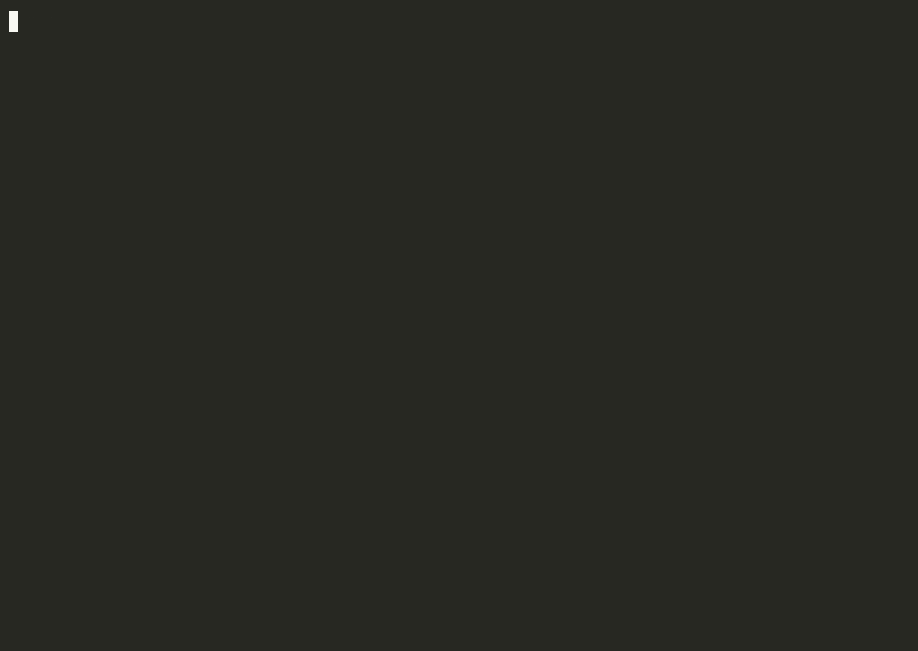

# mcpify

Any scriptable Mac app, as an MCP server your agent can use. mcpify builds the server from the app's own scripting dictionary, then checks every tool against the real app.



<sub>Replay of a recorded run on test data (`demo/demo.jsonl`). Waits are shortened, nothing else is changed.</sub>

```sh
claude mcp add reminders -- npx -y github:abhaymettu/mcpify Reminders
```

## Why

Most Mac apps an agent might drive (Reminders, Calendar, Music, Finder, Keynote, Mail and hundreds of third-party apps) have no API. Many of them do ship an AppleScript dictionary: a machine-readable list of the objects and commands they expose. Agents today either get one "run any AppleScript" tool, or a hand-written server for a handful of apps.

mcpify reads the dictionary and generates typed tools for every class in it, so `Reminders` becomes `list_reminders`, `get_reminder`, `create_reminder`, and so on. It is read-only unless you opt in to writes, and writes need confirmation.

## Results

{{RESULTS}}

## Quick start

Needs macOS and Node 23.6 or newer.

```sh
npx -y github:abhaymettu/mcpify tools Reminders      # list the tools it would generate
npx -y github:abhaymettu/mcpify inspect Calendar     # what the app exposes, * = writable
claude mcp add reminders -- npx -y github:abhaymettu/mcpify Reminders
```

Then ask Claude Code something like "what's left on my Groceries list?". The first call makes macOS ask whether your terminal may control Reminders. Calendar, Contacts and Photos also ask for access to their data.

Writes, inside one list only, with a confirm step:

```sh
claude mcp add reminders -- npx -y github:abhaymettu/mcpify Reminders --writes --scope 'lists[name="Groceries"]'
```

`mcpify apps` lists every scriptable app on your Mac. Any of them works the same way: `mcpify Music`, `mcpify Finder`, `mcpify "/Applications/Some App.app"`.

## What gets generated

For each class an agent can reach from the application object (by default up to four levels deep, so `calendars > events > attendees`):

| Tool | Flag | What it does |
|---|---|---|
| `list_<plural>` | default | Items inside a parent, with `where` filters (text by "contains", others by equality or `{gt, lt}`), `fields` and paging. Each item has a `ref`. |
| `get_<class>` | default | Every readable property of one object, plus counts of what it contains. |
| `get_application` | default | The app's own properties, such as Music's current track or player state. |
| `create_<class>`, `update_<class>` | `--writes` | Typed from the writable properties in the dictionary. |
| app commands | `--writes` | The app's own verbs (Music `play`, Safari `add reading list item`...). |
| `delete_<class>`, destructive commands | `--allow-delete` | Delete, empty, send, erase and similar. |

Objects are addressed by **refs**, paths from the application such as `calendars[name="Work"]/events[id="1F2E..."]`. Every list result carries one, so the agent can pass it back. A ref is parsed in Node, checked against the dictionary, and walked inside `osascript` as data. Agent text never becomes script text.

## Writes, safely

- **Read-only by default.** Without `--writes`, no tool that changes anything is even registered.
- **Confirmation.** If the client supports MCP elicitation, a write asks the user, showing what will change. Otherwise the first call returns a plan (for an update, the current and new values) and a one-time code. The same call with that code carries it out. A code is bound to its exact arguments, expires after 10 minutes and works once. `--confirm none` turns this off.
- **Dry run.** `--dry-run` makes every write return its plan and change nothing.
- **Scope.** `--scope 'lists[name="Groceries"]'` refuses any write whose target is outside that ref. Refs by name and by id are compared after resolving both to ids.
- **Deletes are separate.** `delete_` tools and commands like `empty trash` or `send` exist only with `--allow-delete`.

`test/safety.e2e.test.ts` checks each of these against the real Reminders app.

## How it works

```
App.app ──sdef──▶ dictionary model ──▶ tool set ──▶ MCP server (stdio)
                  (includes, class       list_ get_ create_ ...      │
                   extensions,           each a JXA function         ▼
                   inheritance)                                   osascript ──Apple Events──▶ app
```

1. `sdef` prints the app's dictionary. mcpify resolves `xi:include`s (most apps pull in Apple's Standard Suite this way), merges class extensions and flattens inheritance.
2. It walks the element graph from `application` to find the classes an agent can reach, and which property is each class's identifier (the one with code `ID  `; Calendar calls it `uid`).
3. Each tool is a small JavaScript for Automation function. Arguments travel as JSON on `osascript`'s argv. List tools read each property for the whole collection in one Apple Event, rather than one event per object.

## How it differs from existing work

Two projects already generate MCP code from a dictionary. [sdef-to-mcp](https://ai.rud.is/posts/2026-04-24-sdef-to-md-and-mcp-skill/) produces stubs that need review, and [MCP-server-AppleScript-wrapper](https://github.com/aredigg/MCP-server-AppleScript-wrapper) makes one tool per command. Generic servers like [macos-automator-mcp](https://github.com/steipete/macos-automator-mcp) give the agent one "run this script" tool. Hand-written servers like [apple-mcp](https://github.com/supermemoryai/apple-mcp) and [iMCP](https://github.com/mattt/iMCP) are better than mcpify for the apps they cover.

mcpify's differences:

1. Tools are typed per class and work as generated, for any scriptable app.
2. Every generated tool the sweep can reach is called against the live app, and write round trips are checked with independent `osascript` reads.
3. Writes are gated.
4. There is a measured comparison against the raw-osascript approach.

More detail in [docs/prior-art.md](docs/prior-art.md).

## Limits

{{LIMITS}}

## Reproduce

```sh
git clone https://github.com/abhaymettu/mcpify && cd mcpify && npm install
npm run test:unit                       # dictionary model and generator, no Apple Events
npm test                                # live tests: Notes, Reminders (test lists only)
npm run coverage                        # live sweep over the apps in bench/fixtures.ts
npm run bench                           # agent suite, both arms (uses your Claude Code login)
node bench/summarize.ts bench/results/agent-*.jsonl
```

If your terminal lacks Automation permission for an app, set `MCPIFY_OSASCRIPT` to a wrapper that has it, for example `MCPIFY_OSASCRIPT="my-helper osascript"`. The agent suite exposes the same wrapper to the osascript arm.

`mcpify serve notes` is still there: it runs the hand-written six-tool Notes server from v0, kept for comparison (see [demo/notes-v0](demo/notes-v0)).

## License

MIT
